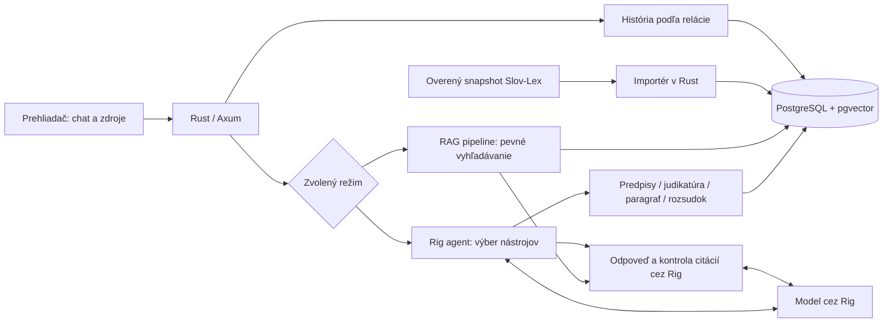
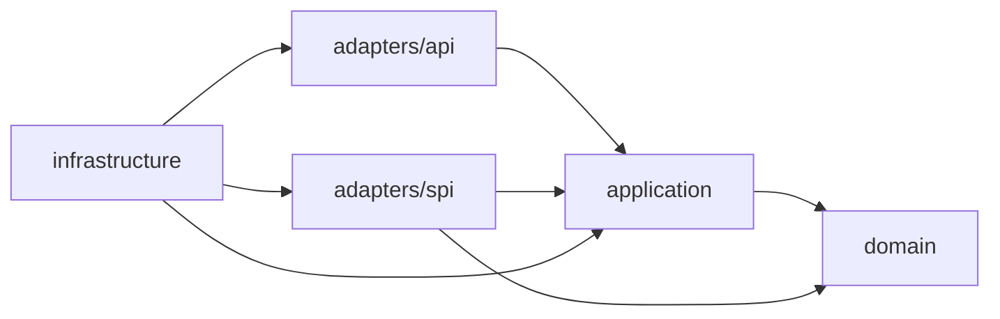

# Lesana — právny asistent s Rig v Ruste

Samostatná Rust aplikácia v priečinku `~/peyco/law`.

Názov aplikácie a spustiteľného súboru je Lesana (`lesana`). Interné názvy Compose projektu, databázy, databázového používateľa a cookie zostávajú `lexa`, resp. `lexa_session`, aby fungovali existujúce dáta a relácie. Identifikátory hodnotiacich prípadov `LEXA-…` zostávajú stabilné.

Používateľ otvorí webový chat, opíše situáciu a vedľa odpovede vidí presné ustanovenia. Každá nová odpoveď sa pripravuje k aktuálnemu dátumu v časovom pásme Europe/Bratislava, aj pri pokračovaní staršieho rozhovoru. Dátumy rozhodujúcich udalostí prípadu model zisťuje v rozhovore a podľa potreby vyhľadá historické znenie. Každé písmeno je samostatný databázový uzol. Pri vyhľadávaní sa zachová celý nadradený odsek vrátane úvodných podmienok a textu za zoznamom. Kliknutie na citáciu zobrazí podklad a odkaz na Slov-Lex aj právne záväzné PDF.

## Spustenie

Z tohto priečinka:

```sh
cp .env.example .env
docker compose up -d --build
```

Otvorte **http://localhost:8088**. PostgreSQL sa inicializuje automaticky, migrácie aj import sa vykonajú pred štartom HTTP servera. Opakovaný štart nevytvorí duplicity. Dáta sú vo volume `lexa_postgres-data`; PostgreSQL port sa na hostiteľovi nezverejňuje.

```sh
docker compose ps
docker compose logs --tail=30 app
docker compose down
```

`down` zachová dáta. Nepoužívajte `down -v`, ak ich chcete zachovať.

Bez modelu aplikácia funguje v jasne označenom **režime rešerše**: vyhľadáva, zobrazuje originálne znenie a ukladá rozhovory. Nevytvára právnu odpoveď, ktorá by sa tvárila ako výstup AI.

## Návrat do prehliadača počas odpovede

Rešerš pokračuje na serveri aj po prerušení spojenia alebo presunutí prehliadača do pozadia. Pri návrate, obnovení internetu alebo načítaní tej istej karty rozhranie obnoví stav existujúcej otázky a načíta uloženú odpoveď; otázku automaticky neposiela druhýkrát. Rozpracovanú otázku a identifikátory uchováva dočasne v `sessionStorage` danej karty a po dokončení ich odstráni. Pri zakázanom úložisku funguje obnovenie v otvorenej stránke, nie po jej opätovnom načítaní. Prípadná chyba modelu sa zobrazí samostatne a otázka zostane v editore.

`POST /api/conversations/{id}/chat` prijíma voliteľné UUID `request_id`. Stav sa číta cez `GET /api/conversations/{id}/chat/{request_id}` (`state: running | completed | failed`); platí rovnaká kontrola relácie a vlastníctva rozhovoru ako pri histórii. Opakovaný známy identifikátor vracia HTTP 409 bez ďalšej rešerše. Stav je v pamäti jedného servera, najviac 1 024 záznamov a najviac hodinu po dokončení; nejde o trvalú deduplikáciu. Po reštarte alebo vypršaní záznamu rozhranie skontroluje uložené správy. Ak sa odpoveď neuložila, zachová otázku na ručné opakovanie. Expirácia alebo vymazanie prihlasovacej cookie naďalej ruší prístup k histórii pôvodnej relácie.

Priebežné SSE udalosti nesmú blokovať rešerš, keď prehliadač prestane čítať. Dokončenie sa zaznamená až po uložení oboch správ do databázy; doručenie výsledku cez pôvodné spojenie má samostatný limit päť sekúnd. Regresné testy prehliadača bez ďalších závislostí: `node --test tests/chat_recovery.test.cjs`. Rust testy obnovy: `cargo test --locked --lib adapters::api::shared`.

Webové súbory sú vložené do Rust binárky. Po zmene treba aplikáciu zostaviť a obnoviť: `docker compose up -d --build --no-deps app`.

## Súbory v rozhovore

Tlačidlom **Priložiť súbory** pod otázkou alebo pretiahnutím do editora možno nahrať textové **PDF, DOCX, TXT a MD**. Každý rozhovor môže obsahovať najviac **5 súborov po 10 MiB**, spolu najviac **100 000 znakov extrahovaného textu**. Súbor nad limit sa odmietne bez tichého skrátenia. TXT a MD musia byť v UTF-8. PDF potrebuje čitateľnú textovú vrstvu; skeny bez textu a dokumenty chránené heslom sa odmietnu. Obrázky sa neanalyzujú a OCR sa pri prílohách nevykonáva. Z DOCX sa číta hlavné telo dokumentu vrátane tabuliek, nie samostatné hlavičky, päty, poznámky pod čiarou či komentáre.

Prílohy sa ukladajú do PostgreSQL pri konkrétnom rozhovore a sú prístupné iba jeho relácii. Pri opätovnom otvorení rozhovoru sa obnoví ich zoznam. Kliknutie na názov stiahne pôvodný súbor; tlačidlo × ho odstráni z ďalšieho kontextu. Vymazanie rozhovoru odstráni aj jeho súbory. Počas odpovede nemožno prílohy meniť, aby model pracoval s jednou konzistentnou sadou podkladov.

Text všetkých aktuálnych príloh sa používa aj pri nasledujúcich otázkach a pri pripojenom modeli sa posiela jeho nakonfigurovanému poskytovateľovi. Oba režimy RAG aj kontrolór odpovede ho dostávajú ako používateľom dodané skutkové podklady. Prílohy sa nepridávajú do spoločnej právnej knižnice a nenahrádzajú overené právne zdroje. V režime bez modelu pomáha krátky úryvok prílohy pri vyhľadávaní; rozbor dokumentu vyžaduje pripojený model. Na spustenie mimo Dockeru sú potrebné `pdftotext` (Poppler) a `unzip`; Docker obraz ich obsahuje.

API vyžaduje reláciu a vlastníctvo rozhovoru; zápisy podliehajú kontrole pôvodu:

- `GET /api/conversations/{id}/attachments` — zoznam metadát.
- `POST /api/conversations/{id}/attachments` — `multipart/form-data` s jediným poľom `file`; vráti `201` a metadáta.
- `GET /api/conversations/{id}/attachments/{attachment_id}` — stiahnutie pôvodného súboru.
- `DELETE /api/conversations/{id}/attachments/{attachment_id}` — odstránenie, odpoveď `204`.

Regresné kontroly rozhrania: `node --test tests/chat_recovery.test.cjs`. HTTP integračné testy na samostatnom testovacom nasadení: `TEST_PASSWORD=test-only-password python3 -B tests/attachments.py http://localhost:8089`; prepínač `agent` navyše preverí oba režimy chatu. Test obsahuje aj samostatný modelový fixture na kontrolu prenosu textu príloh; postup je uvedený v `tests/attachments.py`.

## Pridávanie zdrojov na požiadanie

V dialógu **Predpisy a judikatúra** používateľ zadá požiadavku na pridanie zdroja. Server ju uloží a spracuje na pozadí; zatvorenie dialógu ani reštart aplikácie požiadavku nestratia. Rozhranie zobrazuje čakanie, spracovanie, úspešné uloženie alebo chybu s možnosťou opakovania.

- **Predpis:** číslo a rok, napríklad `311/2001`, alebo odkaz na konkrétne HTML časové znenie na `static.slov-lex.sk`. Pri čísle sa z histórie Slov-Lexu vyberie aktuálne účinná verzia; pre historickú rešerš použite konkrétny odkaz.
- **Judikatúra:** CELEX rozsudku Súdneho dvora alebo Všeobecného súdu, napríklad `62008CJ0243`, alebo slovenský HTML odkaz na EUR-Lexe. Text a RDF metadáta sa načítajú cez [oficiálne publikačné API Cellar](https://op.europa.eu/en/web/cellar/cellar-data/publications), odkazy na citácie zostávajú na EUR-Lexe. Importér podporuje staršie HTML a tabuľkové XHTML s číslovanými bodmi a výrokom. Kontroluje číslo veci, ECLI, dátum a úplnosť štruktúry. Nepodporované dokumenty a neúplné odpovede skončia chybou.

- **Rozhodnutie Najvyššieho súdu Slovenskej republiky:** priamy HTTPS odkaz na textové PDF na `www.nsud.sk/data/att/…pdf` (prijíma sa aj doména `nsud.sk`). Importér overí súd, ECLI `ECLI:SK:NSSR:…`, spisovú značku, dátum a prítomnosť výroku, odôvodnenia a poučenia. Zachová celé rozhodnutie, samostatné strany PDF a výrok; nevytvára fiktívne číslované body. Podporuje rozsudky a uznesenia s touto štruktúrou a hlavičkou. Skeny, nečitateľné strany a nepodporované dokumenty odmietne. Po importe možno vyhľadávať napríklad `4Ndc/31/2024`, `4Ndc/31/2024 strana 2` alebo `ECLI:SK:NSSR:2024:0021203612.1 výrok`. Import vyžaduje PDF odkaz, nie samotné ECLI alebo spisovú značku. Extrakciu zabezpečuje `pdftotext` z Poppleru, ktorý je zahrnutý v Docker obraze; pre lokálne spustenie ho treba nainštalovať samostatne. Kontrolný súčet snapshotu zahŕňa aj SHA-256 pôvodného PDF.

- **Rozhodnutie Najvyššieho súdu Českej republiky – podporná argumentácia:** vyberte tento typ a vložte HTTPS odkaz na konkrétne rozhodnutie z [oficiálnej databázy NS ČR](https://rozhodnuti.nsoud.cz/), napríklad `https://rozhodnuti.nsoud.cz/Judikatura/judikatura_ns.nsf/WebSearch/A4D79508F15A7C04C1258A37004CF0D1?openDocument`. Prijímajú sa aj staršie odkazy na rovnakú databázu z `nsoud.cz` a `www.nsoud.cz` a tlačový variant `WebPrint`; normalizujú sa na jeden zdroj. Samotná spisová značka, ECLI, PDF ani odkaz na zbierku sa pri tomto type nepodporujú. Import overí súd, zhodu ECLI so spisovou značkou a dátumom, výrok, odôvodnenie a záver rozsudku alebo uznesenia. Podporuje aj staršie poučenie bez nadpisu „Poučení:“ a záverečný dátum s českým názvom mesiaca; zhodu dátumu, prítomnosť poučenia a podpisového záveru kontroluje naďalej. Zachová pôvodné české znenie, samostatný výrok, odôvodnenie a prípadnú právnu vetu. Odôvodnenie je vyhľadateľné po nečíslovaných úryvkoch; import nevymýšľa body ani strany PDF. Vyhľadávajte napríklad `33 Cdo 314/2023`, `33 Cdo 314/2023 výrok` alebo `33 Cdo 314/2023 odôvodnenie`. Zdroj aj modelové podklady majú `judgment.supporting_only: true`. Tvorba aj kontrola odpovede vyžadujú označiť český pôvod a podporný charakter; pred prenesením záveru na slovenský prípad treba podložiť porovnanie právnej úpravy, časového znenia a skutkových okolností domácimi alebo použiteľnými európskymi zdrojmi. Česká judikatúra sama nenahrádza podklad pre tvrdenie o slovenskom práve.

- **Nariadenie EÚ:** CELEX pôvodného nariadenia, napríklad `32012R1215`, alebo slovenský odkaz `https://eur-lex.europa.eu/legal-content/SK/TXT/HTML/?uri=CELEX:32012R1215`. Text a metadáta sa načítajú cez Cellar. Import zachová pôvodné slovenské znenie a vytvorí samostatné vyhľadateľné články. Dátum uverejnenia označuje začiatok dostupnosti dokumentu, nie účinnosť ani začiatok uplatňovania. Konsolidované znenia, automatické dopĺňanie noviel a cudzojazyčné verzie sa nepodporujú; pôvodné znenie sa neoznačuje za aktuálne konsolidované právo.

Nové zdroje sú po úspešnom importe ihneď dostupné pre vyhľadávanie aj oba režimy RAG. Naďalej sa uplatňuje dátum právneho stavu; pridanie historickej verzie nemení aktuálny dátum odpovede. Voliteľné embeddingy sa doplnia existujúcim pracovníkom do ďalšieho cyklu indexácie. Zdrojové texty sa nepreberajú z modelovej odpovede.

API: `POST /api/source-requests` s JSON `{"kind":"legislation","reference":"311/2001"}` (alebo `kind: "judgment"`, `kind: "eu_regulation"`, `kind: "supreme_court_judgment"`, `kind: "czech_supreme_court_judgment"`) vráti `202` a stav požiadavky. `GET /api/source-requests` vracia najviac 50 požiadaviek aktuálnej relácie, najprv nedokončené a potom najnovšie ostatné. Oba endpointy vyžadujú reláciu a zápis podlieha existujúcej kontrole pôvodu. Rovnaký kanonický zdroj sa deduplikuje naprieč reláciami; zoznam požiadaviek zostáva súkromný pre reláciu, importovaný korpus je spoločný. Najviac päť nových importov na reláciu a sto celkovo môže čakať alebo bežať naraz. Neúspešný import možno opakovať rovnakým POSTom. Prerušenú úlohu pracovník obnoví po vypršaní 25-minútového zámku.

**Celá čiastka Zbierky stanovísk a rozhodnutí NS SR:** vyberte tento typ zdroja a vložte priamy HTTPS odkaz na PDF čiastky na `nsud.sk`. Lesana pridá všetky očíslované rozhodnutia a stanoviská ako samostatné záznamy s označením `R číslo/rok`, právnou vetou a pôvodnými stranami PDF. Napríklad `R 20/2002`, `R 20/2002 právna veta` alebo `R 20/2002 strana 9`. Zachová sa celé publikované znenie, ktoré môže byť redakčným výňatkom rozhodnutia; chýbajúce ECLI ani výrok sa nevymýšľajú. Staršie skeny sa spracujú slovenským OCR a tento pôvod je označený pri zdroji. OCR môže obsahovať chyby, preto presné citácie porovnajte s PDF.

API prijíma aj `kind: "supreme_court_collection"`. PDF čiastky rozpozná automaticky aj pôvodný typ `supreme_court_judgment`, takže staršiu neúspešnú požiadavku možno zopakovať. `imported_count` uvádza počet záznamov a `node_count` súčet ich textových jednotiek. Obsah čiastky sa kontroluje proti zoznamu záznamov a ukladá v jednej transakcii; chyba neuloží iba časť zbierky a opakovanie nevytvorí duplicity. PDF má limit 100 MiB a 500 strán, OCR 15 minút, celý import 20 minút. Overené sú skenovaná čiastka 2/2002 (16 rozhodnutí) aj textová 4/2025. Nepodporovaný alebo nečitateľný formát skončí vysvetlenou chybou.

Regresný test skenovanej čiastky na oddelenom testovacom nasadení: `TEST_PASSWORD=test-only-password python3 -B tests/supreme_court_collection.py http://localhost:8091`.

## Tech stack a rozhodnutia

| Oblasť | Implementácia |
|---|---|
| Server | Rust, Tokio, Axum 0.8; jedno nasaditeľné binárne spustenie |
| Databáza | PostgreSQL 17, SQLx 0.8.6, verzované SQL migrácie |
| Vyhľadávanie | PostgreSQL full-text `simple`, `unaccent`, `pg_trgm`; voliteľné embeddingy cez `pgvector` a hybridné poradie RRF; presné odkazy na paragraf/odsek/písmeno |
| Orchestrácia | Rig 0.43; prepínateľná RAG pipeline a Agentic RAG so štyrmi typovanými nástrojmi; spoločná kontrola citácií a tvrdení |
| Model | Rig provider pre kompatibilný `/v1/chat/completions` a `/v1/embeddings`; napríklad Ollama. Rust 1.95+ |
| Rozhranie | Responzívne HTML/CSS/JavaScript, vložené priamo do Rust binárky; Node nie je potrebný na beh ani build |
| Priebežný stav | SSE udalosti skutočného priebehu rešerše; hotová odpoveď sa odošle po kontrole pasáží a modelovom posúdení podloženia |
| Nasadenie | Docker Compose; voliteľný Caddy pre HTTPS |

Vyhľadávanie kombinuje full-text s trigramami a po nastavení embeddingového modelu aj sémantickú podobnosť. Prefixy zmierňujú rozdiely v skloňovaní; nejde o plnohodnotný slovenský stemmer. Vektory sú uložené priamo v PostgreSQL. Pri súčasnej veľkosti korpusu sa používa presné kosínusové vyhľadávanie; pri výraznom raste možno doplniť HNSW index pre konkrétny model. Full-textové GIN indexy zostávajú súčasťou databázy.



## Clean Architecture

Projekt používa štruktúru [MSC29/clean-architecture-rust](https://github.com/MSC29/clean-architecture-rust/tree/41f214277f9514a98f100e1707217c095ff1ec11/src): jeden Rust crate, štyri hlavné moduly a samostatné vstupné/výstupné adaptéry. `src/lib.rs` sprístupňuje vrstvy, `src/main.rs` iba spustí `infrastructure::run()`.

```text
src/
├── domain/                    # Entity a pravidlá dôkazov
│   ├── source_entity.rs
│   ├── judgment_entity.rs
│   ├── treaty_entity.rs
│   └── evidence.rs
├── application/
│   ├── repositories/          # Rozhrania úložísk, modelu a udalostí
│   ├── usecases/              # Jednotlivé operácie s execute()
│   ├── mappers/               # Modelový formát ↔ typované dáta
│   ├── utils/                 # Aplikačné chyby a udalosti
│   └── contracts.rs           # Typované vstupy a výstupy
├── adapters/
│   ├── api/                   # Axum controllery, payloady, presentery
│   │   ├── sessions/
│   │   ├── conversations/
│   │   ├── chat/
│   │   ├── catalog/
│   │   ├── search/
│   │   └── shared/            # Routy, stav, cookies, chyby, SSE
│   └── spi/
│       ├── db/                # SQLx, repozitáre, mapovanie, import, index
│       └── http/              # Rig, modelový a embeddingový klient
├── infrastructure/            # Konfigurácia, CLI a zostavenie aplikácie
├── lib.rs
└── main.rs
```

Doména obsahuje entity a pravidlá dôkazov bez databázy, HTTP či modelového JSON parsera. Aplikačné operácie závisia od domény a abstraktných repozitárov. Konkrétne SQLx a Rig implementácie sú vo výstupných adaptéroch `spi`. Infraštruktúra pri štarte zapojí adaptéry do aplikačných operácií a vytvorí HTTP server. Axum, SQLx a Rig zostávajú použitými knižnicami; štruktúra nevyžaduje frameworky z ukážkového projektu.

HTTP controllery volajú tenkú fasádu `Services`, ktorá zostavuje a spúšťa jednotlivé use cases. Validácia relácie, vlastníctva rozhovoru a vstupov je v aplikačných operáciách; repozitáre nie sú dostupné z HTTP stavu. API payloady a presentery patria k svojim funkciám, spoločné cookies, HTTP chyby, ochrana pôvodu a SSE do `api/shared`.

`ChatService` koordinuje kompletný ťah cez `LegalRepository`, `LanguageModel` a `TurnRepository`. `ConversationTurn` drží zámok od načítania histórie po spoločné uloženie oboch správ; nedokončená PostgreSQL transakcia sa pri chybe alebo zrušení zahodí. `ProgressSink` prenáša typované udalosti bez znalosti SSE. Futures a chyby zostávajú `Send`, aby mohli bežať v asynchrónnych Axum/Tokio úlohách.

Porty používajú `ModelMessage`, `StoredMessage`, `ConversationSummary`, `CorpusVersion`, `EmbeddingStatus`, `ResearchRequest` a `ResearchResult`. Databázové mapovanie vrátane `SourceRow` zostáva v `spi/db`. Historické správy si zachovajú `architecture: null`. Modelový JSON dekóduje `application/mappers/evidence_format`; doménové pravidlá dostanú typované tvrdenia. Embeddingový HTTP klient pripravuje vstupy a overuje vektory, databázový index zabezpečuje transakcie, priebežné dopĺňanie a obnovu po chybe.



Pri jednom crate chráni smer závislostí kontrola `python3 tests/architecture.py`: doména neimportuje aplikáciu ani vonkajšie vrstvy, aplikácia neimportuje adaptéry, infraštruktúru či frameworky a API neobchádza use cases priamym prístupom do SPI. Ide o statickú kontrolu zdrojového kódu doplnenú Rust kompiláciou a testami; hranice už nie sú vynucované samostatnými Cargo balíkmi. Pamäťové aplikačné a doménové testy spustí `cargo test --locked --test application_tests --test domain_tests` bez bežiacej databázy či modelu; kompiluje sa spoločná knižnica.

## Prepínanie architektúry

Chat používa predvolene **Agentic RAG** bez prepínača spôsobu rešerše. Pri odoslaní otázky preberá predvolený režim servera, aj pri pokračovaní staršieho rozhovoru vytvoreného cez pipeline. Predvolený režim určuje `RAG_ARCHITECTURE=agentic`; na testovanie možno nastaviť `pipeline`. Zmena tejto premennej vyžaduje opätovné vytvorenie aplikačného kontajnera.

Výber režimu pre jednotlivé otázky zostáva dostupný cez API a v testovacích skriptoch `tests/chat_probe.py` a `tests/legal_eval.py --chat` pomocou `--architecture agentic` alebo `--architecture pipeline`. Bez tohto argumentu použijú predvolený režim servera.

| Režim | Získanie podkladov |
|---|---|
| `pipeline` | Pevné vyhľadávanie otázky a poslednej používateľskej otázky, doplnenie kontextu, návrh odpovede, prípadne jeden ohraničený priechod chýbajúcich podkladov, kontrola citácií a podloženia. Model nedostáva nástroje. |
| `agentic` | Rig agent začína bez automaticky vyhľadaných podkladov. Podľa otázky a histórie si vyberá nástroje aj ich argumenty a ďalšie kroky podľa výsledkov. Potom nasleduje spoločné generovanie a kontrola odpovede. |

Adaptéry nástrojov v `src/adapters/spi/http/research_tools.rs` implementujú Rig `Tool` a volajú aplikačné rozhranie `ResearchTools`:

- `search_norms`: iba predpisy, presné odkazy alebo hybridné vyhľadávanie.
- `search_judgments`: iba importovaná judikatúra, pojmy, číslo veci, ECLI, meno alebo body.
- `get_section`: celý paragraf; povinné číslo a jednoznačný predpis.
- `get_judgment`: importované znenie rozhodnutia alebo záznamu zbierky podľa jednoznačného identifikátora.

Filter druhu zdroja sa aplikuje pred radením fulltextových aj vektorových kandidátov. Server následne dopĺňa nadradený a súvisiaci kontext. Nástroje prijímajú voliteľný `as_of` vo formáte `YYYY-MM-DD` (alebo `null`). Bez neho použijú aktuálny dátum odpovede; pri historickej udalosti môže agent vyhľadať znenie k skoršiemu dátumu z otázky či histórie. Neskorší dátum než aktuálny dátum odpovede server odmietne. Vyhľadanie nemení dátum odpovede a nástroje nemôžu zapisovať do databázy. Výsledok aj uložený záznam volania obsahujú použitý dátum; prázdny výsledok označuje medzeru iba pre daný dotaz a dátum. Nevyhľadávajú na verejnom webe. Nariadenia EÚ aj dohovor sa vyhľadávajú cez existujúci nástroj `search_norms`; judikatúra používa `search_judgments`.

História používateľských správ aj odpovedí asistenta sa odovzdáva rešerši, tvorbe odpovede aj kontrole tvrdení. Kontrolór používa odpovede asistenta iba na porozumenie nadväznosti, nie ako právne dôkazy. Každý agentný ťah musí vykonať platné vyhľadávanie k dátumu rešerše, prípadne k skoršiemu rozhodujúcemu dátumu prípadu. Pred tvrdením o chýbajúcom historickom znení má agent presne dohľadať ustanovenie s historickým `as_of`; aktuálne znenie ani predchádzajúca odpoveď nedokazujú jeho neprítomnosť. Ak model skončí bez nástroja, server rešerš raz zopakuje s rovnakou históriou v rámci zostávajúceho limitu. Preskočené vyhľadávanie alebo iba neplatné volania skončia technickou chybou bez uloženia odpovede; `no_sources` môže vzniknúť až po platnom vyhľadávaní bez výsledku.

`RAG_MAX_TURNS=6` obmedzuje počet modelových volaní jedného pokusu rešerše (rozsah 1–12); jedno volanie môže vyžiadať viac nástrojov, celkovo najviac 24 vykonaných volaní. Rig ich vykonáva postupne. Po vyčerpaní modelových kôl dostane generátor upozornenie `agent_turn_limit` a pracuje len so získanými podkladmi. Časový limit rešerše je 180 sekúnd a celej otázky 300 sekúnd. Pre natívny GPT‑6.1 Sol a DeepSeek V4.1 Flash má rešerš vrátane jedného opakovania po skrátení spoločný limit 600 sekúnd; celá otázka má limit 1 800 sekúnd kvôli rešerši a kontrolám podloženia pri `max`. Text ukončenia rešerše sa nepoužíva ako právny dôkaz. Ak agent nezíska zdroje, server nevytvorí právny záver.

API `POST /api/conversations/{id}/chat` prijíma voliteľné `architecture: "pipeline" | "agentic"`; bez neho použije konfiguráciu servera. SSE odpoveď a história obsahujú `architecture` a `tool_calls` (názov, počet podkladov, výsledok). Rozhranie zobrazuje použité nástroje pri odpovedi. Migrácia `0007_rag_architecture.sql` zachová starú históriu, ktorej neznáma architektúra zostáva `null`. `/api/corpus.rag` oznamuje engine, dostupné režimy a limity. Pole `mode` naďalej označuje výsledok kontroly (`agent`, `agent_partial`, `research_fallback` atď.), nie výber architektúry.

Bez modelu zostáva režim rešerše s deterministickým vyhľadávaním. Adaptéry modelu, agenta aj embeddingových volaní používajú [Rig](https://docs.rs/rig/0.43.0/rig/). PostgreSQL a importy patria do infraštruktúry; kontrola doslovných pasáží patrí do domény.

## Pripojenie modelu

Lesana používa natívny GPT‑6.1 Sol priamo cez OpenAI vo všetkých modelových fázach: rešerš, tvorba odpovede a kontrola podloženia. V `.env` nastavte OpenAI a jeho API kľúč. Kľúč zostáva na serveri; neposiela sa do prehliadača.

```dotenv
LLM_PROVIDER=openai
LLM_BASE_URL=https://api.openai.com/v1
LLM_MODEL=gpt-6.1-sol
LLM_API_KEY=your-openai-api-key
```

Natívny Sol používa uvažovanie `max` vo všetkých troch fázach. Všetky tri fázy idú cez Responses API s `store=false`: rešerš používa nástroje, tvorba odpovede a kontrola ich nemajú a vyžadujú prísne JSON schémy cez `text.format.type=json_schema`. Schémy určujú tvar odpovede a verdiktov; server naďalej samostatne overuje citácie aj podloženie tvrdení. Chat Completions pri natívnom Sol odmieta `reasoning_effort=max`, preto sa pri tomto nastavení nepoužíva. Všetky požiadavky smerujú priamo na `api.openai.com`; modelové volania nepoužívajú OpenRouter ani jeho záložných poskytovateľov. Podporu týchto API a úrovne `max` uvádza [oficiálna dokumentácia GPT‑6.1 Sol](https://developers.openai.com/api/docs/models/gpt-6.1-sol).

Rešerš a tvorba odpovede majú rozpočet 32 000 tokenov vrátane uvažovania a jeden pokus so 64 000 tokenmi pri skrátení. Kontrola má 24 000 tokenov a pri skrátení jednotlivého tvrdenia 48 000. Celá otázka má limit 1 800 sekúnd, rešerš vrátane opakovania 600 sekúnd, jedno generovanie alebo kontrola 360 sekúnd a HTTP transport 365 sekúnd. Skrátený výstup sa nepoužíva ako odpoveď ani na spustenie nástroja. Rozpočty nástrojov zostávajú spoločné pre pokusy; opakovanie vychádza z úplných pôvodných vstupov. Kontroly citácií, podloženia a zachovanie už schválenej časti pri zlyhaní opravy zostávajú aktívne.

Pri dočasnom HTTP 429 natívne Responses zopakuje tú istú požiadavku najviac trikrát. Rešpektuje `Retry-After` alebo `retry-after-ms` do 120 sekúnd; bez použiteľnej hlavičky čaká postupne 2, 4 a 8 sekúnd. Dlhší pokyn na čakanie sa neopakuje. Čakanie aj opakovania sú súčasťou existujúcich časových limitov, nezvyšujú ich. Známe chyby vyčerpanej kvóty alebo fakturácie sa neopakujú a vracajú `model_payment`. Diagnostika obsahuje iba pevnú kategóriu chyby, počet pokusov a dĺžku čakania, nikdy telo odpovede, API kľúč alebo obsah konverzácie.

Alternatívne možno použiť OpenRouter:

```dotenv
LLM_PROVIDER=openrouter
LLM_BASE_URL=https://openrouter.ai/api/v1
LLM_MODEL=deepseek/deepseek-v4.1-flash
OPENROUTER_API_KEY=your-openrouter-api-key
```

OpenRouter používa samostatný `OPENROUTER_API_KEY`. Adaptér naň nikdy nepoužije `LLM_API_KEY` určený pre priamy OpenAI alebo iný kompatibilný server. Bez OpenRouter kľúča aplikácia oznámi chýbajúcu konfiguráciu. `LLM_PROVIDER=auto` (predvolené) rozpozná presný hostiteľ `openrouter.ai`; explicitné `openrouter` slúži aj pre vlastný proxy endpoint. Podporované hodnoty sú `auto`, `openrouter` a `openai` (všeobecný OpenAI-kompatibilný protokol).

DeepSeek V4.1 Flash (`deepseek/deepseek-v4.1-flash`) používa Chat Completions a `reasoning_effort=max` vo všetkých fázach. OpenRouter prednostne použije CoreWeave (`coreweave/fp8`), pri zlyhaní Together (`together`). Nastavenie `only` obmedzuje smerovanie na týchto dvoch poskytovateľov; `require_parameters=true` vyžaduje podporu všetkých odoslaných parametrov a `allow_fallbacks=true` povoľuje zálohu v rámci tohto výberu. Rešerš má limit 32 000 výstupných tokenov na kolo vrátane uvažovania. Pri skrátení sa raz zopakuje z pôvodného zadania a úplnej konverzačnej histórie s limitom 64 000 tokenov na kolo; skrátené volania nástrojov sa nevykonajú ani neprenesú do opakovania. Rozpočty a počítadlá vyhľadávacích nástrojov zostávajú spoločné pre oba pokusy. Tvorba odpovede má rozpočet 32 000 tokenov vrátane uvažovania; pri skrátení sa raz zopakuje z úplných vstupov s rozpočtom 64 000. DeepSeek kontroluje tvrdenia jednotlivo s rozpočtom 24 000 tokenov a pri skrátení raz zopakuje kontrolu s 48 000 tokenmi. Najviac dve kontroly bežia súbežne. Tvorba odpovede a kontrola tvrdení používajú prísne JSON schémy; DeepSeek dostáva rovnakú úplnú schému aj v systémovej správe. DeepSeek má aj hranice výsledného JSON: najviac 6 vecných tvrdení po 1 800 znakov, po 1 až 6 dôkazov a najviac 4 otázky po 500 znakov. Kontrola vracia najviac jeden verdikt so zdôvodnením do 250 znakov. Tieto hranice obmedzujú dĺžku odpovede a rozsah následnej kontroly, nemenia úroveň uvažovania. Rig prenáša `reasoning_details` spolu s volaniami nástrojov do ďalšieho kola. Uvažovanie sa nepoužíva ako citovaný dôkaz. Celkový limit otázky je 1 800 sekúnd (30 minút). DeepSeek aj natívny Sol majú na celú rešerš vrátane prípadného opakovania 600 sekúnd; ostatné modely 180 sekúnd. Limit jednej tvorby či kontroly je pre DeepSeek a natívny Sol 360 sekúnd a HTTP transport má limit 365 sekúnd aj pre volania počas rešerše; ostatné modely zostávajú na 120/125 sekundách. Ide o horné hranice, dokončená odpoveď sa vracia okamžite. Kontroly podloženia odpovede sa neobchádzajú.

Na porovnanie Qwen cez rovnaký účet zmeňte `LLM_MODEL=qwen/qwen3.8-27b`. Qwen3.8‑27B používa explicitne `reasoning_effort=xhigh` pri rešerši, tvorbe odpovede aj kontrole tvrdení. Rešerš má limit 16 384 výstupných tokenov na kolo (vrátane uvažovania). OpenRouter požaduje poskytovateľa podporujúceho odoslané parametre (`require_parameters=true`). Prednostne skúsi Cerebras a ModelRun (`order`), ďalších poskytovateľov zoradí podľa rýchlosti generovania (`sort=throughput`) a ponechá povolené zálohy (`allow_fallbacks=true`). Pri tvorbe odpovede a kontrole tvrdení sa posielajú samostatné prísne JSON schémy (`response_format.type=json_schema`, `strict=true`), ktoré povoľujú iba polia danej fázy. Poskytovateľa bez podpory štruktúrovaného výstupu automaticky vynechá. Kontrola formátu, platnosti citácií aj právneho podloženia na serveri platí naďalej. Výsledná cena závisí od vybraného poskytovateľa; najnižšia cena nie je prioritou. Kontrola dôkazov aj existujúce časové limity zostávajú zachované. Model musí na zvolenom endpointe podporovať volanie nástrojov a JSON odpovede. Zmena modelu sa prejaví po obnovení kontajnera:

```sh
docker compose up -d --no-deps --force-recreate app
```

Pri alternatívnom GPT‑6.1 Sol cez OpenRouter (`openai/gpt-6.1-sol`) rešerš používa Responses API, `reasoning.effort=low`, `store=false` a limit 12 000 výstupných tokenov na modelové kolo. OpenRouter adaptér Rig používa jeho vlastný formát systémových správ a prenáša kompletnú históriu, výsledky nástrojov aj šifrované položky uvažovania medzi kolami; nepoužíva serverové uloženie rozhovoru. Generovanie odpovede a kontrola tvrdení používajú Chat Completions bez nástrojov, s uvažovaním `low` a `response_format: {"type":"json_object"}`. Skrátenú rešerš (`incomplete/max_output_tokens`) adaptér odmietne aj pri zdanlivo platnom texte či volaní nástroja.

Po úprave kódu adaptéra treba aplikáciu znovu zostaviť:

```sh
docker compose up -d --build --no-deps app
```

Natívne pripojenie používa `LLM_PROVIDER=openai`, `LLM_BASE_URL=https://api.openai.com/v1`, `LLM_MODEL=gpt-6.1-sol` a `LLM_API_KEY`. Lokálna Ollama používa napríklad:

```dotenv
LLM_PROVIDER=auto
LLM_BASE_URL=http://host.docker.internal:11434/v1
LLM_MODEL=qwen3:8b
LLM_API_KEY=
```

Príklad predpokladá už bežiacu Ollamu a stiahnutý model. Na Linuxe musí byť server dostupný z Docker siete. Model sa spolu s aplikáciou automaticky neinštaluje. Embeddingy majú vlastnú konfiguráciu a zmena chatového poskytovateľa ich nemení. Prázdne `LLM_BASE_URL` aj `LLM_MODEL` ponechajú aplikáciu v režime vyhľadávania zdrojov.

Dokumentácia: [OpenRouter Responses](https://openrouter.ai/docs/api_reference/responses/overview), [OpenRouter GPT‑6.1 Sol](https://openrouter.ai/openai/gpt-6.1-sol), [GPT‑6.1 Sol – požiadavky OpenAI](https://developers.openai.com/api/docs/models/gpt-6.1-sol).

Model dostáva otázku, posledných najviac 16 správ daného rozhovoru a nájdené ustanovenia. Pri vzdialenom poskytovateľovi teda tieto údaje opúšťajú hostiteľa. Pre on-premise použite modelový server vo vlastnej infraštruktúre. Na Raspberry Pi odporúčam prevádzkovať web, Rust server a databázu; väčší model umiestniť na výkonnejší stroj alebo použiť API.

## Embeddingy a hybridné vyhľadávanie

Embeddingový model sa nastavuje nezávisle od chatového modelu. Predvolene je vypnutý. V `.env` vyplňte `EMBEDDING_BASE_URL` a `EMBEDDING_MODEL`, prípadne `EMBEDDING_API_KEY`. Server musí prijímať `POST /v1/embeddings` s poľami `model`, `input` (pole reťazcov), `encoding_format: "float"` a vracať `data` s indexom a číselným vektorom pre každý vstup. Rozmer sa zistí z prvej platnej odpovede.

Príklad pre existujúcu lokálnu Ollamu a už stiahnutý model (voľbu modelu treba overiť na slovenských otázkach):

```dotenv
EMBEDDING_BASE_URL=http://host.docker.internal:11434/v1
EMBEDDING_MODEL=nomic-embed-text
EMBEDDING_API_KEY=
EMBEDDING_QUERY_PREFIX="search_query: "
EMBEDDING_DOCUMENT_PREFIX="search_document: "
EMBEDDING_REVISION=
EMBEDDING_MIN_SIMILARITY=0.35
```

Prefixy sú závislé od modelu; ak ich model nevyžaduje, nechajte ich prázdne. Embeddingové API dostáva pôvodné texty ustanovení s citáciami, nadpismi a nadradeným kontextom a pri vyhľadávaní text otázky. Pri vzdialenom serveri tieto údaje opúšťajú hostiteľa. API kľúč zostáva na serveri a automaticky sa nepreberá z konfigurácie chatového modelu.

Compose používa PostgreSQL 17 s rozšírením `vector`. Pri prechode zo staršej verzie Lesany zachovajte existujúci volume a bežnú zálohu; `docker compose up -d --build` vymení DB image a aplikuje novú migráciu. Na vlastnom PostgreSQL treba najprv nainštalovať pgvector; migračný účet musí mať oprávnenie na `CREATE EXTENSION vector` aj pri vypnutom embeddingovom modeli.

Po štarte beží dopĺňanie embeddingov na pozadí. Vychádza z už importovaných aj nových predpisov a každých 60 sekúnd kontroluje chýbajúce alebo zmenené texty. Text delí na úseky po 1 800 znakov s presahom 200 znakov a API volá v dávkach do 16 vstupov. Dlhý text sa neodreže; výsledky viacerých úsekov sa zlúčia na pôvodné ustanovenie s jednou citáciou. Dokončené dávky sa pri reštarte neopakujú a nedokončená dávka sa uloží až po úplnom úspechu.

Na jednorazové doplnenie a čakanie na dokončenie:

```sh
docker compose run --rm app embed
```

Príkaz `lesana import` pri nakonfigurovanom embeddingovom modeli po úspešnom importe doplní aj vektory. Ak embeddingové API zlyhá, importované predpisy zostanú uložené a príkaz skončí s chybou; vektory možno doplniť opakovaným `embed`. Stav je dostupný v `/api/corpus` pod `embeddings`: `enabled`, `model`, `indexed_nodes`, `total_nodes`, `ready`. `ready` znamená úplnosť indexu pre aktuálnu konfiguráciu, nie priebežnú kontrolu dostupnosti poskytovateľa.

Bežná otázka spustí textové a vektorové vyhľadávanie súbežne. Každá vetva vyberie najviac 48 kandidátov, poradia sa spoja cez Reciprocal Rank Fusion (`1 / (60 + poradie)`) a vrátia sa najviac 12 ustanovení. Vektorová vetva používa kosínusovú podobnosť s nastaviteľnou minimálnou hodnotou `EMBEDDING_MIN_SIMILARITY`; predvolených `0.35` treba vyhodnotiť pre zvolený model. Obe vetvy uplatňujú rovnaký zákon a evidovaný rozsah účinnosti. Presné citácie ako `§ 181 SSP` sa riešia priamo bez volania embeddingového API. Rovnakú hybridnú funkciu používa vyhľadávanie v rozhraní, pipeline aj agentove nástroje `search_norms` a `search_judgments` s príslušným filtrom druhu zdroja.

Karty podkladov aj výsledkov vyhľadávania zobrazujú dole štítky **Fulltext**, **Embedding** alebo **Presný odkaz** s ikonou; kliknutie či Enter na štítkoch rozbalí vysvetlenie. Pri nájdení viacerými spôsobmi sa zachovajú všetky štítky, aj naprieč volaniami nástrojov agenta. Pole `retrieval_methods` (`fulltext`, `embedding`, `exact`) sa ukladá spolu so zdrojmi do snímky odpovede. Staršie odpovede bez tohto údaja zobrazia **Spôsob nezaznamenaný**.

Pri tvorbe odpovede server ku každému nájdenému odseku či písmenu doplní celý nadradený paragraf alebo článok z rovnakej časovej verzie. Napríklad k § 216 ods. 2 písm. c) TZ dostane model aj celý § 216 vrátane odseku 1. Tieto podklady vstupujú aj do katalógu citovateľných pasáží. Platí to pre úvodné vyhľadávanie, kontext predošlej otázky aj výsledky `search_norms` a `get_section`; presné výsledky samostatného vyhľadávania zostávajú nezmenené.

Server ďalej sleduje pôvodné HTML odkazy zo Slov-Lexu do iných ustanovení a poznámok pod čiarou, najviac do hĺbky dvoch odkazov. Cieľ sa načíta podľa identity zákona a dátumu konkrétneho vyhľadania, až po overení existencie presného cieľa. Podporované paragrafové rozsahy zahŕňajú aj vložené paragrafy s písmenom. Migrácia `0005_reference_links.sql` pridáva odvodené väzby; štart ich doplní aj k existujúcim snapshotom bez zmeny právnych textov, ID a embeddingov. Automaticky doplnené zdroje majú štítok **Súvisiace ustanovenie** (`related`).

Kontext má najviac 60 zdrojov a 180 000 bajtov textu a kontextu; najviac 60 000 bajtov môžu využiť odkazované ustanovenia. Z jedného zdroja sa spracuje najviac 40 odkazov a z jedného rozsahu najviac 20 paragrafov. Pri rešerši viacerých dátumov sa odkazy rozvíjajú pre každý dátum samostatne a novšia časová verzia nezastúpi staršiu. Cykly v rámci toho istého dátumu sa neopakujú. Model dostáva `context_issues` s príslušným `as_of`, ktoré odlišujú chýbajúce znenie k dátumu od limitov dopĺňania či odkazu na celý zákon vyžadujúceho ďalšiu rešerš. Odkazy na neimportované predpisy, nepodporované väzby a vecné súvislosti bez hyperlinku sa nenahrádzajú odhadom. Katalóg nie je zoznam celej databázy; model má pred tvrdením o nedostupnosti ustanovenia použiť presné dohľadanie.

V režime `pipeline`, ak návrh odpovede výslovne oznámi chýbajúce právne podklady, server podľa textu takých tvrdení vykoná ešte jeden rešeršný priechod (najviac tri dotazy). V režime `agentic` všetky rešeršné dotazy vyberá Rig agent cez svoje nástroje; automatický priechod podľa návrhu sa nevykonáva. Pri tomto kroku vyhľadáva podľa pojmov; číslo paragrafu opisujúce nedostatočný zdroj nepresmeruje dotaz na presné vyhľadanie. Keď pribudnú zdroje, obnoví katalóg a nechá návrh prepracovať pred kontrolou podloženia. Rozpoznávanie je jazyková heuristika; nenahrádza úplnú kontrolu pokrytia právnych otázok. Nové zdroje podliehajú rovnakým dátumovým a kontextovým limitom aj kontrole citácií.

Pri nedostupnom API, chybnej odpovedi alebo prekročení 5 sekúnd pri embeddingu otázky sa vrátia textové výsledky. Počas počiatočného indexovania sa používajú už hotové vektory spolu s full-textom. Zmena endpointu, modelu, prefixov alebo `EMBEDDING_REVISION` vytvorí samostatný index a zabráni miešaniu nekompatibilných vektorov. Ak poskytovateľ vymení váhy pod rovnakým názvom modelu, zmeňte `EMBEDDING_REVISION`; zmena rozmeru bez novej revízie sa odmietne. Staršie indexy zostanú uložené pre prípad návratu k predchádzajúcej konfigurácii.

## Naplnené predpisy a pôvod dát

Knižnica obsahuje deväť predpisov zo Slov-Lexu. Pôvodných sedem bolo overených **1. 10. 2026**, Občiansky zákonník a zákon o ochrane spotrebiteľa **2. 10. 2026**:

| Predpis | Účinnosť verzie od | Paragrafy | Články | Odseky | Písmená | Všetky uzly |
|---|---|---:|---:|---:|---:|---:|
| 162/2015 Z. z. — Správny súdny poriadok (SSP) | 12. 6. 2026 | 523 | 0 | 971 | 462 | 2 129 |
| 160/2015 Z. z. — Civilný sporový poriadok (CSP) | 15. 7. 2026 | 483 | 18 | 919 | 233 | 1 793 |
| 161/2015 Z. z. — Civilný mimosporový poriadok (CMP) | 17. 8. 2026 | 404 | 14 | 725 | 135 | 1 365 |
| 71/1967 Zb. — Zákon o správnom konaní (správny poriadok, SP) | 1. 9. 2018 | 85 | 0 | 226 | 26 | 366 |
| 372/1990 Zb. — Zákon Slovenskej národnej rady o priestupkoch (ZoP) | 1. 9. 2026 | 90 | 0 | 237 | 228 | 656 |
| 300/2005 Z. z. — Trestný zákon (TZ) | 18. 8. 2026 | 528 | 0 | 1 565 | 1 793 | 4 072 |
| 301/2005 Z. z. — Trestný poriadok (TP) | 18. 8. 2026 | 643 | 0 | 2 127 | 636 | 3 621 |
| 40/1964 Zb. — Občiansky zákonník (OZ) | 31. 7. 2026 | 687 | 0 | 1 382 | 192 | 2 526 |
| 108/2024 Z. z. — Zákon o ochrane spotrebiteľa a o zmene a doplnení niektorých zákonov (ZoS) | 27. 9. 2026 | 133* | 25 | 731 | 584 | 2 143 |

*ZoS má 60 vlastných paragrafov v čl. I a 73 paragrafov citovaných v novelizačných článkoch. Počty uzlov zachovávajú celý HTML dokument. Citované znenia zostávajú uložené s označením novelizačného článku a bodu, ale neindexujú sa ako samostatné ustanovenia ZoS. Napríklad `§ 619 ZoS` nevráti citovanú novelu OZ; aktuálne znenie sa načíta cez `§ 619 OZ`. Prílohy č. 2 a 3 sú v HTML dostupné iba ako odkazy na PDF.

Počty zahŕňajú vložené paragrafy s písmenom v čísle a nečíslované odseky. Počty číslovaných bodov: SSP 2, SP 3, ZoP 37, TZ 4, TP 14, OZ 30 a ZoS 364 (vrátane novelizačných bodov). Celkovo je importovaných **18 671 uzlov**, vrátane častí, hláv, dielov, skupín, príloh a 288 poznámok pod čiarou. Poznámky sa uchovávajú s pôvodnými kotvami ako samostatné nevyhľadateľné uzly; ich odkazy nenahrádzajú import citovaných predpisov. Verzia TP má na Slov-Lexe uvedený koniec účinnosti 31. 12. 2027; dostupnosť v aplikácii zostáva obmedzená dátumom overenia 1. 10. 2026.

Oficiálne zdroje:

- SSP: [HTML](https://static.slov-lex.sk/static/SK/ZZ/2015/162/20260612.html), [právne záväzné PDF](https://static.slov-lex.sk/pdf/SK/ZZ/2015/162/ZZ_2015_162_20260612.pdf).
- CSP: [HTML](https://static.slov-lex.sk/static/SK/ZZ/2015/160/20260715.html), [právne záväzné PDF](https://static.slov-lex.sk/pdf/SK/ZZ/2015/160/ZZ_2015_160_20260715.pdf).
- CMP: [HTML](https://static.slov-lex.sk/static/SK/ZZ/2015/161/20260817.html), [právne záväzné PDF](https://static.slov-lex.sk/pdf/SK/ZZ/2015/161/ZZ_2015_161_20260817.pdf).
- SP: [HTML](https://static.slov-lex.sk/static/SK/ZZ/1967/71/20180901.html), [právne záväzné PDF](https://static.slov-lex.sk/pdf/SK/ZZ/1967/71/ZZ_1967_71_20180901.pdf).
- ZoP: [HTML](https://static.slov-lex.sk/static/SK/ZZ/1990/372/20260901.html), [právne záväzné PDF](https://static.slov-lex.sk/pdf/SK/ZZ/1990/372/ZZ_1990_372_20260901.pdf).
- TZ: [HTML](https://static.slov-lex.sk/static/SK/ZZ/2005/300/20260818.html), [právne záväzné PDF](https://static.slov-lex.sk/pdf/SK/ZZ/2005/300/ZZ_2005_300_20260818.pdf).
- TP: [HTML](https://static.slov-lex.sk/static/SK/ZZ/2005/301/20260818.html), [právne záväzné PDF](https://static.slov-lex.sk/pdf/SK/ZZ/2005/301/ZZ_2005_301_20260818.pdf).
- OZ: [HTML](https://static.slov-lex.sk/static/SK/ZZ/1964/40/20260731.html), [právne záväzné PDF](https://static.slov-lex.sk/pdf/SK/ZZ/1964/40/ZZ_1964_40_20260731.pdf).
- ZoS: [HTML](https://static.slov-lex.sk/static/SK/ZZ/2024/108/20260927.html), [právne záväzné PDF](https://static.slov-lex.sk/pdf/SK/ZZ/2024/108/ZZ_2024_108_20260927.pdf).

Slov-Lex označuje HTML ako informatívne. PDF je autoritatívny dokument; aplikácia naň odkazuje. Prílohy s obsahom zákona dostupné len ako PDF sa nespracúvajú ako normatívny text. HTML prílohy so zoznamom preberaných aktov a tabuľkové prílohy Trestného zákona sú zahrnuté.

Originálne HTML snapshoty sú v `data/ssp-20260612.html`, `data/csp-20260715.html`, `data/cmp-20260817.html`, `data/sp-20180901.html`, `data/zop-20260901.html`, `data/tz-20260818.html`, `data/tp-20260818.html`, `data/oz-20260731.html` a `data/zos-20260927.html`. Metadáta sú v `data/manifest.json`, `data/csp-20260715.json`, `data/cmp-20260817.json`, `data/sp-20180901.json`, `data/zop-20260901.json`, `data/tz-20260818.json`, `data/tp-20260818.json`, `data/oz-20260731.json` a `data/zos-20260927.json`: zdroje, dátumy, očakávané počty a SHA-256. Importér overuje kontrolné súčty, počty paragrafov, písmen a článkov, pri všetkých predpisoch okrem pôvodného manifestu SSP aj celkové počty uzlov a odsekov, jedinečnosť kotiev a väzby na rodičov. Test porovnáva importované kotvy s nezávislým plochým zoznamom všetkých štruktúrnych uzlov HTML. Import prebieha transakčne a existujúca časová verzia sa neprepisuje iným zdrojom. Pri štarte sa automaticky importuje všetkých deväť predpisov; opakovaný štart nevytvára duplicity.

Automatické sťahovanie noviel nie je zapnuté. Server pri každej otázke určí dnešný dátum v Europe/Bratislava; dátum sa neukladá pri štarte aplikácie ani nepreberá zo starej správy. Chat API už dátum neprijíma (prípadné staré pole `as_of` ignoruje). Katalóg vracia dnešný `default_date` a samostatné vyhľadávanie ho použije, ak nedostane explicitný historický `as_of`. Predpisy sa vyhľadávajú podľa evidovanej účinnosti `valid_from`/`valid_to` a novších importovaných verzií. `verified_on` označuje posledné overenie snapshotu, nie koniec účinnosti; zostáva pri zdrojoch a model ho nesmie vydávať za potvrdenie aktuálnosti k dnešku. Chýbajúce časové pokrytie jedného predpisu nenahrádza znenie iného predpisu. Historické znenia treba doplniť samostatne.


## Judikatúra

Prvý importovaný rozsudok je **C-464/01, Johann Gruber proti Bay Wa AG**, Súdny dvor (druhá komora), **20. 1. 2005**, **ECLI:EU:C:2005:32**, CELEX `62001CJ0464`. Oficiálne slovenské [HTML](https://eur-lex.europa.eu/legal-content/SK/TXT/HTML/?uri=CELEX:62001CJ0464) a [PDF](https://eur-lex.europa.eu/legal-content/SK/TXT/PDF/?uri=CELEX:62001CJ0464) sú z EUR-Lexu. Snapshot `data/gruber-20050120.html` a manifest `data/gruber-20050120.json` boli overené 2. 10. 2026.

Import obsahuje celé znenie, všetkých **56 bodov** aj **výrok**, spolu 58 uzlov (57 vyhľadateľných). Importér overuje SHA-256, poradie a úplnosť bodov, prítomnosť výroku a celkový počet uzlov. Pokračovania, citácie predpisov, otázky a odrážky zostávajú pri príslušnom bode. Abstrakt pred rozsudkom nevstupuje do textu rozhodnutia.

Vyhľadávanie podporuje `Gruber`, `C-464/01`, `ECLI:EU:C:2005:32`, `62001CJ0464`, `Gruber výrok` a `C-464/01 body 39–41, 46 a 54` (najviac 20 odkazov). Vecné dotazy hľadajú v bodoch aj výroku cez spoločný fulltext a voliteľné embeddingy. Agent k bodu dostane celé rozhodnutie ako kontext; citácie sa overujú rovnakou kontrolou pasáží ako pri predpisoch. Interné kotvy bodov sa nepripájajú k EUR-Lex URL, pretože toto HTML nemá kotvy bodov.

Migrácia `0006_judgments.sql` pridáva voliteľné metadáta `acts.judgment`. Existujúce predpisy a uložené odpovede zostávajú kompatibilné. Pri rozsudku `valid_from` interne znamená dátum rozhodnutia; rozhranie používa `judgment.decided_on` a označenie „Rozhodnutie z“. Rozhodnutie je dostupné od dátumu rozhodnutia; dátum overenia snapshotu jeho dostupnosť neukončuje. Pridanie rozsudku nerozširuje časové pokrytie jednotlivých zákonov. Overenie zdroja nie je kontrolou neskoršej judikatúry.

Právnym rámcom Grubera sú články 13 až 15 Bruselského dohovoru a súdna právomoc pri spotrebiteľských zmluvách s dvojakým účelom. Model má výslovný pokyn odlíšiť argumenty strán a vnútroštátnych súdov od záverov Súdneho dvora a neprenášať test zanedbateľného podnikateľského účelu automaticky na OZ, ZoS alebo iný režim.

## Dáta a import ďalších verzií

`acts` → `act_versions` → `legal_nodes`. Každý uzol má `parent_anchor`, typ, poradie, označenie, presnú citáciu, vlastný text, úplný text, nadradený kontext a pôvodnú HTML kotvu. Časové verzie majú `valid_from`, `valid_to`, `verified_on`, zdrojové URL a checksum. Rozhovory a ich správy ukladajú dátum rešerše aj snímku použitých zdrojov.

Príklady: `paragraf-3.odsek-1.pismeno-b` → `§ 3 ods. 1 písm. b)`; `paragraf-1.odsek-1.pismeno-a` → `§ 1 písm. a)`. Technický uzol nečíslovaného odseku nevytvorí neexistujúce označenie „ods. 1“. Základné princípy CSP a CMP sa ukladajú ako články s odsekmi, napr. `predpis.text2.clanok-2.odsek-1` → `Čl. 2 ods. 1`.

Pri vyhľadávaní možno určiť predpis skratkou, názvom alebo číslom zákona: `§ 362 CSP`, `§ 158 CMP`, `§ 181 SSP`, `§ 362 zákona č. 160/2015`, `čl. 2 ods. 1 CMP`, `§ 54 ods. 2 SP`, `§ 54 Správneho poriadku`, `§ 54 zákona č. 71/1967 Zb.`, `§ 2 ZoP`, `§ 212 TZ`, `§ 34 TP`, `§ 88aa ZoP`, `§ 305aa TZ`, `§ 420 ods. 1 OZ`, `§ 420 Občianskeho zákonníka`, `§ 20 ZoS` alebo `§ 20 zákona o ochrane spotrebiteľa`. Bez určenia predpisu sa vrátia ustanovenia z dostupných zákonov; každá citácia obsahuje číslo zákona.

Ďalší overený snapshot rovnakého Slov-Lex HTML formátu sa importuje cez `lesana import SOURCE.html MANIFEST.json`. Pripravte manifest s novou účinnosťou, overeným hashom a skontrolovanými počtami; samotná zmena počtov na odhad nie je kontrola úplnosti. Cez Docker:

```sh
docker compose run --rm -v "$PWD/data:/import:ro" app import /import/novy-predpis.html /import/novy-manifest.json
```

Pri viacerých verziách sa vyberá posledná evidovaná účinná verzia k dátumu rešerše. Aktuálna knižnica obsahuje SSP, CSP, CMP, Správny poriadok (SP), zákon o priestupkoch (ZoP), Trestný zákon (TZ), Trestný poriadok (TP), Občiansky zákonník (OZ) a zákon o ochrane spotrebiteľa (ZoS, 108/2024 Z. z.); neobsahuje judikatúru. Odkazy na tieto zdroje treba doplniť ďalším importom.

## Lokálne, Raspberry Pi, cloud a on-premise

| Prostredie | Prístup používateľa a nasadenie |
|---|---|
| Lokálny počítač | Docker Compose → `localhost:8088` |
| Raspberry Pi 4/5 | 64-bit Linux/ARM64, Docker Compose, trvalý PostgreSQL volume ideálne na SSD; prístup cez privátnu sieť/VPN |
| On-premise | Rovnaké kontajnery na Linux serveri; interná doména, TLS cez firemný proxy, lokálny model |
| AWS | Rovnaký aplikačný obraz na EC2/Compose alebo ECS; PostgreSQL môže byť RDS |
| Azure | Rovnaký obraz na VM/Compose alebo Container Apps; databáza môže byť Azure Database for PostgreSQL |

V1 je overená na **linux/arm64**. Dockerfile používa obrazy dostupné aj pre linux/amd64; nasadenie na fyzickom Pi a v AWS/Azure nebolo vykonané. 32-bit ARM nie je cieľ tejto verzie. Pre distribúciu na oba 64-bit ciele:

```sh
docker buildx build --platform linux/amd64,linux/arm64 -t YOUR_REGISTRY/lesana:0.1.0 --push .
```

Na vlastný PostgreSQL nastavte `DATABASE_URL` alebo `PGHOST`, `PGPORT`, `PGDATABASE`, `PGUSER`, `PGPASSWORD`; pre spravovanú databázu aj TLS (`sslmode=verify-full` a príslušná CA podľa poskytovateľa). Účet pre migrácie potrebuje vytvoriť rozšírenia `unaccent`, `pg_trgm` a `vector` (pgvector musí byť na serveri nainštalovaný). Po úvodnej konfigurácii možno oddeliť migračný účet a runtime účet; v1 ich používa spoločne.

Predvolený port je viazaný len na `127.0.0.1`. V súkromnej LAN možno nastaviť `BIND_ADDRESS=0.0.0.0` a `APP_PASSWORD`. Verejný prístup je pripravený cez Caddy (Compose ≥ 2.24.4):

```dotenv
APP_DOMAIN=pravo.example.com
APP_PASSWORD=replace-with-a-long-random-password
POSTGRES_PASSWORD=replace-before-first-database-start
```

```sh
docker compose -f compose.yaml -f compose.https.yaml up -d --build
```

Tento variant odstráni priamy port aplikácie, zapne Secure cookies a poskytne HTTPS. Vyžaduje DNS smerujúce na server a porty 80/443. Nesmie sa súčasne verejne sprístupniť testovací model. Pri už existujúcom PostgreSQL volume samotná zmena `POSTGRES_PASSWORD` v `.env` nemení heslo databázovej roly.

Prístup vo v1: voliteľné spoločné heslo pracovného priestoru a samostatná náhodná HttpOnly/SameSite relácia pre každý prehliadač. Rozhovory sú oddelené podľa relácie. Relácia platí 30 dní; vymazanie cookies alebo jej expirácia znamená stratu prístupu k histórii z daného prehliadača. Nie sú tu ešte používateľské účty, obnova prístupu ani synchronizácia medzi zariadeniami. Pre tímový produkt je ďalším krokom OIDC/SSO a väzba histórie na používateľské konto. Toto spoločné heslo nie je náhrada za plnohodnotnú správu identít.

Záloha databázy:

```sh
docker compose exec -T db pg_dump -U lexa -d lexa -Fc > lesana.backup
```

## Overenie a vývoj

```sh
cargo fmt --all --check
cargo clippy --all-targets --locked -- -D warnings
cargo test --locked
python3 tests/architecture.py
python3 -m unittest discover -s tests -p test_architecture.py
node --check web/app.js
docker compose exec -T app lesana check-corpus
python3 tests/smoke.py http://localhost:8088
TEST_PASSWORD=test-only-password python3 tests/source_requests.py http://localhost:8091
# Samostatná testovacia databáza, vyžaduje prístup k oficiálnemu PDF NS SR:
TEST_PASSWORD=test-only-password python3 -B tests/supreme_court.py http://localhost:8091
# Český Najvyšší súd – živý HTML import na oddelenom testovacom nasadení
TEST_PASSWORD=test-only-password python3 -B tests/czech_supreme_court.py http://localhost:8093
# Samostatná testovacia databáza, vyžaduje prístup k oficiálnemu API EÚ:
TEST_PASSWORD=test-only-password python3 tests/eu_regulations.py http://localhost:8089
```

Rust build bol vykonaný vo verzii 1.98.1 v oficiálnom kontajneri; Dockerfile pinuje build image digest a `Cargo.lock` uzamyká závislosti. Rust ani Node netreba inštalovať pre Docker nasadenie. Zmeny UI sú vložené do binárky a vyžadujú nový build.

Natívny Sol má samostatnú HTTP fixture: kontroluje Responses API vo všetkých fázach, odmietnutie Chat Completions, OpenAI kľúč, `max`, prísne JSON schémy, návrat výsledkov nástrojov a šifrovaného uvažovania aj opakovania po skrátení. Skrátené nástroje sa nesmú vykonať ani preniesť do opakovania. Simuluje tiež HTTP 429 vo všetkých fázach, vyčerpanie počtu pokusov a neobnoviteľnú chybu kvóty; overuje počet pokusov aj zhodu celej opakovanej požiadavky. Testy používajú dočasnú databázu a fiktívne kľúče:

```sh
docker compose build app
docker compose -p lesana-native-check -f compose.test.yaml -f compose.native-sol-test.yaml --profile test up -d --no-build --wait test-db mock-model agent-test
TEST_PASSWORD=test-only-password python3 -B tests/rag_modes.py http://localhost:8089
docker compose -p lesana-native-check -f compose.test.yaml -f compose.native-sol-test.yaml --profile test exec -T mock-model python -B /tests/openrouter_protocol.py http://agent-test:8080 http://127.0.0.1:9000
docker compose -p lesana-native-check -f compose.test.yaml -f compose.native-sol-test.yaml --profile test down
```

OpenRouter adaptér má samostatnú HTTP fixture: kontroluje prefix modelu, oddelený API kľúč, Responses rešerš, návrat výsledkov nástrojov aj šifrovaného uvažovania a Chat JSON odpovede. Testy nevolajú platené API ani nehodnotia právnu kvalitu:

```sh
docker compose build app
docker compose -p lesana-openrouter-check -f compose.test.yaml -f compose.openrouter-test.yaml --profile test up -d --no-build --wait test-db mock-model agent-test
TEST_PASSWORD=test-only-password python3 -B tests/rag_modes.py http://localhost:8089
python3 -B tests/openrouter_protocol.py http://localhost:8089
docker compose -p lesana-openrouter-check -f compose.test.yaml -f compose.openrouter-test.yaml --profile test down
```

Pre rovnaké protokolové testy s Qwen pridajte do príkazov Compose ešte `-f compose.qwen-test.yaml`. Fixture vyžaduje uvažovanie `xhigh` vo všetkých fázach Qwenu, podporu parametrov a limit výstupu rešerše.

Testy `tests/application/use_cases.rs` používajú pamäťové implementácie rozhraní. Overujú oba režimy RAG, históriu, uloženie až po validácii, rollback pri zlyhaní modelu, chybu zápisu, neplatný vstup, dátum bez pokrytia, limity nástrojov, vlastníctvo rozhovorov a odmietnutie vypršanej relácie bez HTTP. `tests/domain/evidence_rules.rs` overuje dôkazy a čiastočné odpovede bez JSON a asynchrónneho runtime. Databázové testy sú štandardne ignorované; proti dočasnému PostgreSQL ich spustí `DATABASE_URL=... cargo test --locked -- --ignored`. Zahŕňajú aj zámok rozhovoru, kontrolu vlastníka, historické správy s neznámou architektúrou a rollback pri chybe druhého zápisu.

Protokolové integračné testy modelu a embeddingov bez API účtu používajú samostatný Compose projekt a dočasnú DB v pamäti. Nemenia databázu bežiacej aplikácie:

```sh
docker compose -p lesana-embedding-check -f compose.test.yaml --profile test build agent-test
docker compose -p lesana-embedding-check -f compose.test.yaml --profile test up -d --wait test-db mock-model agent-test embedding-test
TEST_PASSWORD=test-only-password python3 tests/smoke.py http://localhost:8089 agent
TEST_PASSWORD=test-only-password python3 tests/rag_modes.py http://localhost:8089
TEST_PASSWORD=test-only-password python3 tests/smoke.py http://localhost:8090
python3 tests/embeddings.py
python3 tests/embedding_storage.py
docker compose -p lesana-embedding-check -f compose.test.yaml --profile test run --rm embedding-test embed
# Pri hotovom indexe posledný príkaz vypíše Indexed 0 nodes.
docker compose -p lesana-embedding-check -f compose.test.yaml --profile test down
```

Testy kontrolujú skutočný PostgreSQL import, citáciu písmena, kontext, nečíslované odseky, rozsah dátumov, vyhľadávanie bez diakritiky, izoláciu rozhovorov, SSE, persistenciu, volanie nástroja modelom a odmietnutie neexistujúcej citácie alebo chyby poskytovateľa. Embeddingové testy overujú nájdenie zdroja bez textovej zhody, časové a zákonné filtre, pôvod citácie, poradie dávkovej odpovede, návrat k full-textu pri chybe, nesprávnom rozmere či časovom limite a použitie v chate. Testovacie rozhovory sa po teste mažú. Mock model je len test protokolu; úspech testu neoveruje kvalitu právneho uvažovania ani sémantického vyhľadávania reálneho modelu.

Deterministická kontrola potvrdzuje existenciu zdroja a doslovnosť priradenej pasáže; následná modelová kontrola posudzuje podloženie tvrdenia. Ani táto kombinácia nezaručuje právnu správnosť alebo úplnosť výkladu. Pred rozšírením používania treba vyhodnotiť reálny model na právnikmi skontrolovaných otázkach, doplniť súvisiace predpisy, historické znenia a meranie kvality rešerše. Streamovanie jednotlivých tokenov, prílohy používateľa a automatické aktualizácie predpisov zatiaľ nie sú implementované.

Technické referencie: [Axum](https://docs.rs/axum/latest/axum/), [SQLx](https://docs.rs/sqlx/0.8.6/sqlx/), [PostgreSQL pg_trgm](https://www.postgresql.org/docs/17/pgtrgm.html), [pgvector](https://github.com/pgvector/pgvector), [Ollama kompatibilné API](https://docs.ollama.com/api/openai-compatibility).


## Prvý balík kvality odpovedí (2. 10. 2026)

Presné vyhľadávanie spracuje viacero ustanovení naraz: `§ 54 SP a § 181 SSP`, `§ 181 a 182 SSP`, `§ 54 ods. 2 SP a § 362 ods. 1 CSP` aj `čl. 2 CSP a čl. 2 CMP`. Zákony, odseky a písmená sa priraďujú ku konkrétnym odkazom; výsledky sa neduplikujú. Neexistujúci odsek ani písmeno sa už nenahradí nadradeným paragrafom. Rozsahy a skrátené zoznamy odsekov treba rozpísať (`§ 181 ods. 1 a § 181 ods. 4 SSP`); nejednoznačný zápis vráti zrozumiteľnú chybu. Limit je 20 explicitných odkazov. Nástroj `get_section` má voliteľný parameter `act` (napr. `SSP`, `71/1967`); neznámy či nejednoznačný zákon sa odmietne.

Model odovzdáva `claims` a `questions`. Každé tvrdenie má `text` a neprázdne `evidence`. Model vyberá dvojicu `source_id`, `passage_id` z katalógu úryvkov pripraveného serverom; server doplní doslovné `quote` a inline odkazy. Pasáže zachovávajú pôvodné znenie aj biele znaky, dlhé texty sa delia na slovných hraniciach s presahom. Starší vstup s `quote` zostáva podporovaný, ale musí naďalej prejsť prísnou kontrolou doslovnosti; nepresné parafrázy sa neakceptujú. Voľný text odpovede mimo tohto formátu sa neprijíma. Samostatné doplňujúce otázky môžu byť bez citácií a majú režim `clarification`.

Neplatná schéma návrhu spustí jeden samostatný pokus o opravu s konkrétnou chybou parsera; nespotrebuje pokus na vecnú opravu. Ak zlyhá aj táto oprava, ide o technickú chybu `model_response`, nie o chýbajúce právne podklady. Server toleruje iba vonkajší Markdown blok okolo JSON; nemení obsah tvrdení, citácií ani identifikátorov a neprijíma ďalšie polia. Každý opravený návrh ďalej prechádza kontrolou zdrojov aj podloženia. Do logov ide iba tvar polí, bez textu odpovede alebo diagnostických hodnôt od modelu.

Pred zverejnením odpovede nasleduje kontrola rovnakým nakonfigurovaným modelom, ktorá posúdi každé tvrdenie oproti jeho vlastným pasážam a kontextu. Kontroluje aj otázky s možným nepodloženým predpokladom. Po prvom zamietnutí má model jeden pokus na opravu celého návrhu a dostane konkrétnu spätnú väzbu kontrolóra ako dáta. Ak aj po oprave časť návrhu neprejde, ale kontrola je úplná a platná, Lesana ponechá iba tvrdenia s výslovným kladným verdiktom a ich zdroje. Neschválené doplňujúce otázky vynechá; ich zamietnutie nezahodí schválené právne tvrdenia. Výsledok uloží ako `agent_partial` a označí ako čiastočnú odpoveď s upozornením na neúplnosť. Chýbajúci alebo duplicitný verdikt, neplatný formát či nesprávna citácia neumožňujú považovať tvrdenie za podložené. Ak kontrola návrh vecne zamietne a neostane žiadne podložené tvrdenie, Lesana vráti `research_fallback`: nájdené ustanovenia bez právneho záveru. Táto modelová kontrola je omylná a nenahrádza právnu kontrolu. Pridáva modelové volania, latenciu a prípadné náklady podľa poskytovateľa. Údaj `retrieval_methods` slúži iba rozhraniu a histórii; do podkladov generátora ani kontrolóra sa neposiela.

Migrácia `0004_claim_evidence.sql` ukladá tvrdenia a pasáže v `messages.claims`. Staršie správy majú prázdne pole a zostávajú čitateľné. Rozhranie ponúka rozbalenie **Tvrdenia a podkladové pasáže**, vrátane odkazov na zdroje; funguje aj po opätovnom otvorení rozhovoru.

Neplatný JSON alebo neúplné indexy verdiktov spustia jeden samostatný pokus na opravu formátu kontroly toho istého návrhu. Nejde o automatické schválenie; opravený výsledok musí znovu prejsť všetkými kontrolami. Už kladne posúdená časť prvého návrhu zostáva dostupná aj vtedy, keď následná oprava odpovede zlyhá na citáciách, formáte kontroly alebo technickej chybe modelu vrátane vyčerpania výstupného rozpočtu. Do výsledku sa nikdy nepreberajú tvrdenia bez kladného verdiktu. Po získaní kladne skontrolovanej časti server pri opravách sleduje zostávajúci čas celého ťahu. Posledných 15 sekúnd rezervuje na uloženie odpovede; ďalšiu opravu nezačne, ak na ňu pred touto hranicou nezostáva čas na jedno modelové volanie (DeepSeek a natívny Sol 360 sekúnd, ostatné modely 120 sekúnd). Prebiehajúca oprava a jej kontrola skončia najneskôr na tejto hranici a vrátia už overenú časť ako `agent_partial`. Prvá neúplná kontrola bez overeného návrhu takýto čiastočný výsledok neumožňuje.

Predvolená kontrola prebieha v skupinách najviac troch tvrdení, najviac dve skupiny súbežne. Každá má vlastné lokálne indexy; server ich prenesie späť na pôvodný návrh. Ak kontrola skupiny vyčerpá limit 6 000 tokenov, skupina sa rozdelí na jednotlivé tvrdenia; pri jednotlivom tvrdení je jeden pokus s limitom 12 000. DeepSeek pri `max` rovno kontroluje jednotlivé tvrdenia s limitom 24 000 a jedným opakovaním pri skrátení s limitom 48 000; preskočí tak zbytočné skrátené skupinové kontroly. Natívny Sol pri `max` ponecháva skupiny najviac troch tvrdení, so základným rozpočtom 24 000 tokenov a opakovaním jednotlivého tvrdenia do 48 000. Generovanie návrhu má predvolene limit 12 000 tokenov, DeepSeek a natívny Sol 32 000 s jedným opakovaním pri skrátení do 64 000. Všetky rozpočty zahŕňajú uvažovanie aj výsledný JSON. `finish_reason=length` sa nikdy neakceptuje ako úplná odpoveď ani ako negatívny právny verdikt; opakovanie používa pôvodné úplné podklady, nie skrátený výstup. Neopraviteľné skrátenie alebo neplatný formát sa vrátia ako technická chyba modelu, nie ako nedostatočné právne podloženie. Ak už bol pred opravou kladne skontrolovaný nezávislý úsek odpovede, pri zlyhaní opravy sa vráti len tento úsek ako `agent_partial`. Do logov sa zapisujú iba fáza, rozpočet, spôsob ukončenia, čas, veľkosť výstupu v bajtoch, poskytovateľ a dostupné počty výstupných tokenov a tokenov uvažovania, nikdy obsah otázky, odpovede alebo uvažovania. Chýbajúce údaje o tokenoch zostávajú neznáme. Diagnostika navyše zaznamená podiel bielych znakov, výsledok syntaktického parsovania JSON a prítomnosť úvodného označenia uvažovania bez záznamu samotného textu.

### Pracovná hodnotiaca sada

`tests/legal_cases.json` vo verzii 1.2.1 obsahuje 63 otázok: 30 presných odkazov, 14 otázok s viacerými ustanoveniami, 10 prirodzených otázok a 9 prípadov chýbajúceho znenia alebo odkazu. Pri očakávaných ustanoveniach je referenčný text zo snapshotu, URL, identita predpisu a hodnotiaca rubrika. Všetky prípady majú stav `pending_legal_review`: **nejde o právnikom schválenú sadu odpovedí**. Polia `human_review` sú pripravené na kontrolu správnosti, úplnosti a podloženia.

Vyhodnocovací nástroj kontroluje zhodu snapshotov a pri porovnaní aj zhodu testovacej sady. Pri presných otázkach vyžaduje presné ustanovenia bez zdrojov z iného zákona. Pri prirodzených otázkach meria prítomnosť očakávaného ustanovenia alebo jeho hierarchicky súvisiaceho uzla; nemeria tým úplnosť právnej odpovede. `--chat` navyše zbiera odpovede skutočného modelu pre ľudské hodnotenie a maže vytvorené testovacie rozhovory. Bez tohto prepínača modelové odpovede nevyhodnocuje. Model musí byť v cieľovej aplikácii pripojený; testovací mock slúži iba na protokolové testy.

```sh
TEST_PASSWORD=test-only-password python3 tests/legal_eval.py --base http://localhost:8089 --output test-results/legal-before.json
# Po úprave aplikácie a pri rovnakej sade i korpuse:
TEST_PASSWORD=test-only-password python3 tests/legal_eval.py --base http://localhost:8089 --output test-results/legal-after.json --compare test-results/legal-before.json
# Na aplikácii so skutočným modelom (nie mock-model):
TEST_PASSWORD=your-password python3 tests/legal_eval.py --base http://localhost:8088 --chat --ids LEXA-001 LEXA-025 --output test-results/legal-model-sample.json
python3 -B tests/test_legal_eval.py
```

V pôvodnej sade 1.0 na izolovanej databáze a rovnakých siedmich snapshotoch prešlo pred zmenou **37/50** vyhľadávacích scenárov a po zmene **50/50**, bez regresie v tejto sade. Opravených bolo 12 viacnásobných odkazov a náhrada neexistujúceho odseku paragrafom. Výsledky sú v `test-results/legal-before.json` a `test-results/legal-after.json`. Tieto čísla **nepredstavujú percento právne správnych odpovedí**. Testy navyše overujú vymyslené pasáže, nesprávny zdroj, nepodložený verdikt, neúplnú kontrolu, opravu, doplňujúce otázky a persistenciu pasáží. Kvalita reálneho modelu vyžaduje vyhodnotenie odpovedí právnikom.


### Rozlíšenie zlyhaní odpovede

Nepodložené tvrdenie, neplatné ID pasáže alebo nepresný úryvok po jednom pokuse o opravu vedú na `research_fallback`, pokiaľ neexistuje kladne posúdená časť odpovede. Neúplný či neplatný kontrolný verdikt po oprave formátu, vyčerpaný výstupný limit a výpadok poskytovateľa zostávajú technickou chybou; nevydávajú sa za zamietnutie právneho záveru. SSE chyba obsahuje kód `model_unavailable`, `model_configuration`, `model_payment`, `model_busy`, `model_response`, `model_output_limit`, `timeout` alebo `request_failed` a príslušnú používateľskú správu. HTTP 402 sa zobrazí ako nedostatok kreditu alebo limit účtu poskytovateľa (`model_payment`), nie ako výpadok spojenia. Chybové logy neobsahujú text otázky, odpovede ani vecný obsah spätnej väzby kontrolóra.

Jednu otázku so skutočným modelom možno reprodukovať cez `tests/chat_probe.py`. Výstup rozlišuje odpoveď agenta, rešeršné podklady a chybu a obsahuje čas spracovania. Dočasný rozhovor sa odstráni; heslo sa nevypisuje:

```sh
python3 -B tests/chat_probe.py --env-file .env --architecture agentic --question 'Aký je rozdiel medzi kradezou a vlamanim?' --output test-results/theft-after.json
```

## Pridanie Občianskeho zákonníka (2. 10. 2026)

OZ je súčasťou automatického importu, knižnice a vyhľadávania podľa skratky, názvu aj čísla zákona. Snapshot účinný od 31. 7. 2026 zachováva všetkých 2 526 štruktúrnych uzlov vrátane 687 paragrafov, prílohy a poznámok pod čiarou. Staršie znenia OZ zatiaľ nie sú importované.

Prešlo 36 Rust testov vrátane izolovaného PostgreSQL testu kontextových väzieb, kontrola formátovania, Clippy a HTTP integračné testy. Rozšírená vyhľadávacia sada 1.1 prešla **55/55** na ôsmich snapshotoch; výsledok je v `test-results/legal-oz.json`. Prípad LEXA-047 teraz overuje chýbajúce historické znenie OZ k 30. 7. 2026. Výsledok sa priamo neporovnáva so sadou 1.0 a nemeria právnu správnosť modelových odpovedí.

## Pridanie zákona o ochrane spotrebiteľa (2. 10. 2026)

Zákon č. 108/2024 Z. z. v znení účinnom od 27. 9. 2026 je súčasťou automatického importu, knižnice a vyhľadávania cez `ZoS`, plný názov aj číslo zákona. Zachováva všetkých 2 143 štruktúrnych uzlov HTML. Vlastné ustanovenia sú v čl. I; citované novelizačné znenia majú odlíšené citácie a nevracajú sa ako samostatné paragrafy ZoS ani cez presné vyhľadávanie, nástroj `get_section`, rozsahy či sémantický index. Staršie znenia ZoS a zrušený zákon č. 250/2007 Z. z. nie sú importované. Prílohy dostupné iba ako PDF nie sú spracované ako text.

Prešlo 38 Rust testov vrátane PostgreSQL integračného testu, Clippy, kontrola formátovania a HTTP integračné testy. Sada 1.2 prešla **63/63** vyhľadávacích scenárov na deviatich snapshotoch (`test-results/legal-zos.json`), vrátane dátumových hraníc, rozlíšenia zákona od predchodcu a citovaných noviel. Tento výsledok nemeria právnu správnosť odpovedí modelu.

## Prechod na Rig (3. 10. 2026)

Oba režimy používajú Rig 0.43.0 na modelové volania aj embeddingy. V režime Agentic RAG vedie rešerš agent cez typované nástroje; výber režimu, použité nástroje a overené tvrdenia sa ukladajú ku každej odpovedi. Migrácia `0007_rag_architecture.sql` zachováva staršiu históriu.

Prešlo **41 Rust testov** vrátane oboch PostgreSQL testov, formátovanie, Clippy bez varovaní, HTTP a embeddingové integračné testy a **14 scenárov prepínania architektúry a volania nástrojov**. Vyhľadávacia sada prešla **63/63** (`test-results/legal-rig.json`). Verzia sady 1.2.1 dopĺňa odtlačok existujúceho snapshotu Gruber; otázky a očakávania zostávajú rovnaké ako v 1.2.

Pri skúške s pripojeným modelom `qwen` vytvorili oba režimy overenú odpoveď na otázku k bodu 39 rozsudku Gruber. Agent si sám vybral `search_judgments`; pipeline odpovedala bez volania nástrojov. Záznamy sú v `test-results/rig-real-agentic.json` a `test-results/rig-real-pipeline.json`. Ide o kontrolu zapojenia reálneho modelu na jednej otázke, nie o hodnotenie celkovej právnej kvality.


## Bruselský dohovor (1968)

Knižnica obsahuje anglickú konsolidáciu Bruselského dohovoru o súdnej právomoci a výkone rozhodnutí v občianskych a obchodných veciach, uverejnenú **26. 1. 1998**, CELEX **41998A0126**. [EUR-Lex HTML](https://eur-lex.europa.eu/legal-content/EN/TXT/HTML/?uri=CELEX:41998A0126) a [PDF](https://eur-lex.europa.eu/legal-content/EN/TXT/PDF/?uri=CELEX:41998A0126). Snapshot bol získaný cez verejný odkaz na stiahnutie z [Úradu pre publikácie EÚ](https://op.europa.eu/en/publication-detail/-/publication/0e63083c-47ab-4e17-9f94-c319950e98dc/), uložený v `data/brussels-19980126.html` a overený 3. 10. 2026. Manifest uchováva aj presnú adresu stiahnutia a SHA-256.

Import zachováva 71 článkov dohovoru (1–68 vrátane 6a, 12a a 54a), 11 článkov pripojeného protokolu a 14 článkov protokolu o výklade z roku 1971. Ide o 96 vyhľadateľných článkov a 100 uzlov spolu. Preambuly, poznámky a vyhlásenia zostávajú v celom dokumente. HTML uvádza pri bibliografických tabuľkách iba zástupný text; tabuľky sú v sprievodnom PDF. Články sa nečlenia na vymyslené číslované odseky. Protokoly majú samostatné interné kotvy; interné kotvy sa nepripájajú k pôvodnej URL.

Príklady hľadania: `čl. 13 BD`, `čl. 13, 14 a 15 Bruselského dohovoru`, `Article 6a Brussels Convention`, `čl. Vd pripojeného protokolu BD`, `čl. 13 protokolu o výklade BD`. Samotný názov, `BD` alebo `CELEX:41998A0126` vrátia celý dokument. Agent používa pre články nástroj `search_norms`; pôvodné dôkazové úryvky zostávajú v angličtine.

Migrácia `0008_treaties.sql` pridáva voliteľné metadáta `acts.treaty`. Pri tomto archívnom texte `valid_from` predstavuje dátum publikácie; rozhranie zobrazuje „Konsolidácia uverejnená“. Dostupnosť snapshotu medzi publikáciou a overením nie je potvrdením jeho právnej použiteľnosti. Samotná konsolidácia nemá záväznú právnu silu, čo uvádza jej predbežná poznámka. Časovú a územnú pôsobnosť treba posúdiť osobitne. Dohovor sa nesmie zamieňať s nariadeniami Brusel I a Brusel Ia.

Sada `tests/legal_cases.json` vo verzii 1.3 dopĺňa odtlačok dohovoru a osem scenárov pre články, protokoly, dátum publikácie a odlíšenie nariadenia 1215/2012. Hodnotí dohľadanie zdrojov, nie právnu správnosť odpovede.

Pri voľnom hľadaní v dohovore sa po určení predpisu odstráni spoločný názov z hodnotenia relevancie a vybrané slovenské pojmy sa rozšíria o anglické ekvivalenty (napríklad spotrebiteľ → consumer, zmluva → contract). Ide iba o vyhľadávací slovník; pôvodné právne znenie sa nemení.


Overenie dohovoru: prešlo 43 Rust testov vrátane troch databázových integračných testov, formátovanie, Clippy bez varovaní, HTTP kontroly a 71/71 scenárov vyhľadávania (`test-results/legal-brussels.json`). Živá aplikácia má 11 zdrojových verzií a dokončený index 13 337 vyhľadateľných uzlov. Kontrola ôsmich presných dotazov vrátane OZ, ZoS a Grubera a slovenskej otázky k spotrebiteľským zmluvám je v `test-results/brussels-live.json`; prvé tri výsledky prirodzeného dotazu sú články 14, 13 a 15 dohovoru. Knižnica a karta článku 13 boli overené aj v prehliadači.

Skúška pripojeného modelu `qwen` na článku 14 použila `search_norms`, správny zdroj a pôvodné anglické citácie (`test-results/brussels-real-agentic.json`). Slovenský výklad obsahoval nepresný preklad bydliska a príliš široké tvrdenie o vymáhaní plnenia mimo štátu bydliska. Táto skúška potvrdzuje iba zapojenie zdroja a citácií, nie právnu ani jazykovú správnosť generovanej odpovede; zistenia sú zaznamenané v poli `verification`.
